# FlyBot

**Smart insect traps: the camera shoots, the AI counts.**

FlyBot watches sticky and lure traps through cameras in the orchard, counts the insects on every photo with AI (fruit flies first), and tells growers when a trap crosses its threshold and what to do about it. It runs in the browser and installs on the phone like an app, in Vietnamese and English.

Website: <https://ezviz.agrhub.com> · Contact: <contact@agrhub.com>

[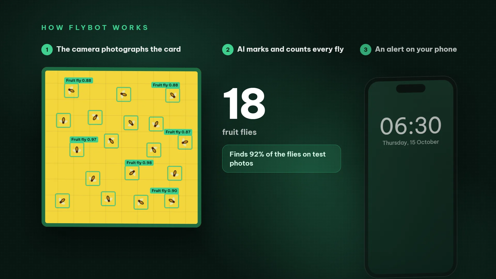](https://ezviz.agrhub.com/media/flybot-tvc-en.mp4)

Commercial (1080p, 60 s, with music): [English](https://ezviz.agrhub.com/media/flybot-tvc-en.mp4) · [Tiếng Việt](https://ezviz.agrhub.com/media/flybot-tvc-vi.mp4); 9:16 for social media (30 s): [English](https://ezviz.agrhub.com/media/flybot-tvc-vertical-en.mp4) · [Tiếng Việt](https://ezviz.agrhub.com/media/flybot-tvc-vertical-vi.mp4). Product tour (1080p, 86 s): [English](https://ezviz.agrhub.com/media/flybot-tour-en.mp4) · [Tiếng Việt](https://ezviz.agrhub.com/media/flybot-tour-vi.mp4). The files are also in the repository: [client/public/media](client/public/media).

## What FlyBot does for a grower

- **Counts every trap, every photo.** Sticky traps count the daily rise on the glue card; lure traps count the average per photo. Flies per trap per day compare traps, plots and weeks fairly.
- **Warns in time.** Per-trap thresholds, sudden rises, plots over their limit, a weather-based "wave of flies is coming" warning, by email, Telegram and phone notifications, with quiet hours and a 06:30 morning brief.
- **Says what to do next.** A to-do card per plot (treat now, check the effect, bait before the next generation, sanitation), a treatment log with VietGAP export, and the effect of each treatment on the catches.
- **Answers questions.** The FlyBot assistant looks up the real data (catches, alerts, cameras, treatments), shows photos and charts, takes a new photo, and asks the vision agent to look at a photo in depth ("why did the count jump today?"). Anything it proposes only happens after you press Confirm.
- **Keeps the cameras healthy.** Live view, playback, scheduled captures, photo quality checks (dark, blurry, full card), a card-replacement reminder, battery and signal of solar cameras.
- **Works for one farm or a cooperative.** Farms with plots on a map, organizations with owner/manager/member roles, sharing per camera, farm or report, a cooperative overview and report.
- **Reports and data.** A report builder with scheduled PDF emails, shareable links with expiry, PDF/Excel export with the detection boxes, a public API and webhooks ([API.md](API.md)).

## Main screens

<table>
<tr>
<td width="50%">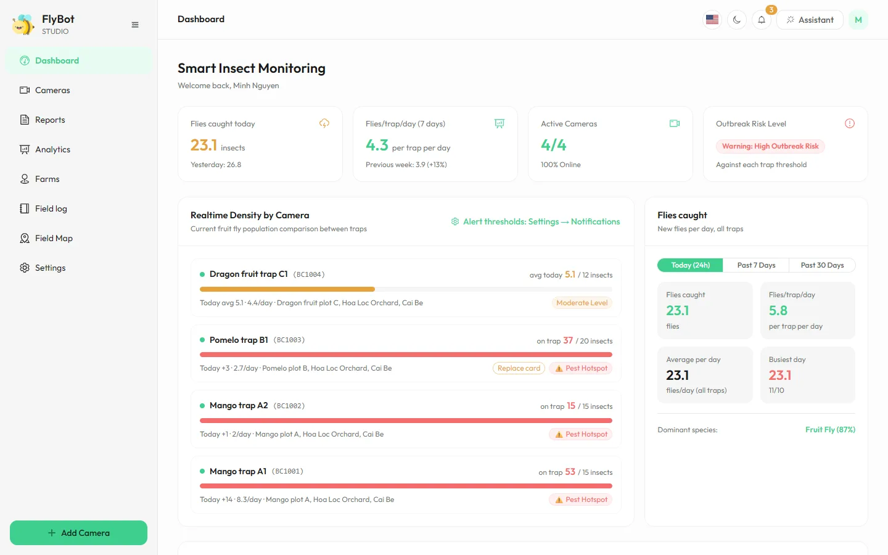<br><sub><b>Overview:</b> flies caught today, flies per trap per day, every trap against its threshold</sub></td>
<td width="50%">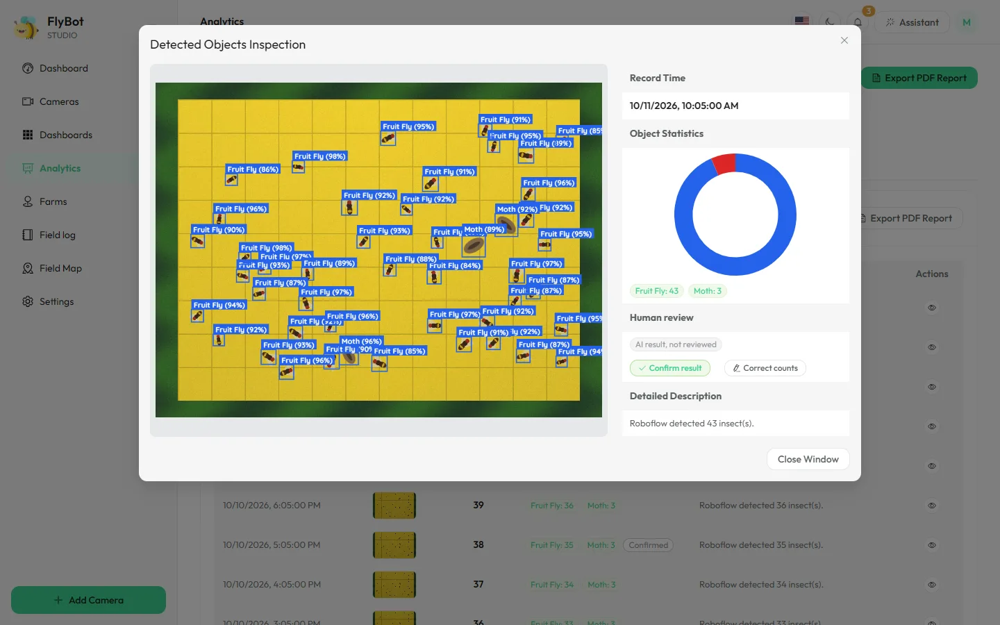<br><sub><b>AI detection:</b> every fly boxed and counted; confirm or correct the count</sub></td>
</tr>
<tr>
<td width="50%">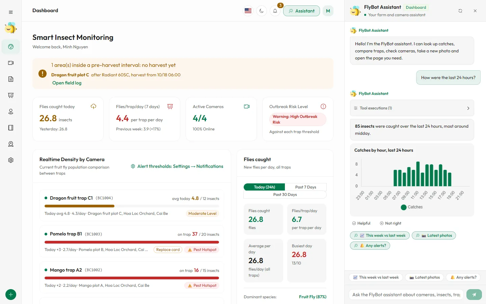<br><sub><b>FlyBot assistant:</b> answers from real data, with photos and charts</sub></td>
<td width="50%">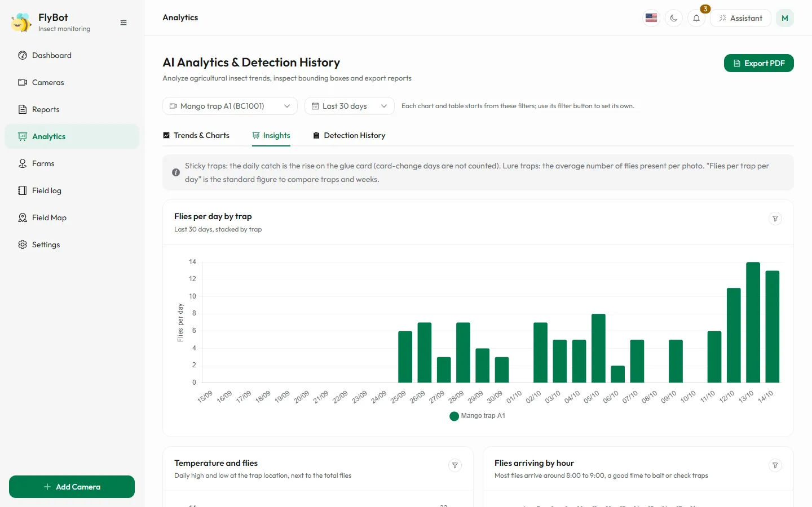<br><sub><b>In-depth analysis:</b> per-trap table, daily catches, temperature, catches by hour</sub></td>
</tr>
<tr>
<td width="50%">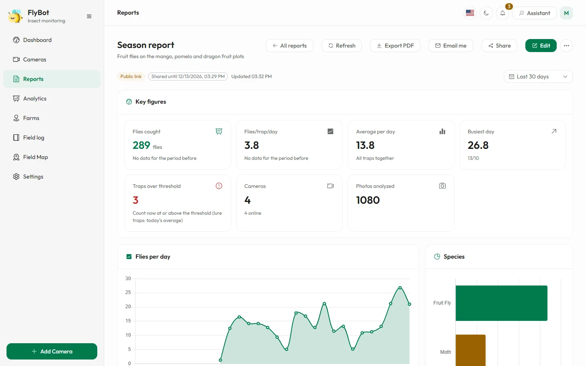<br><sub><b>Reports:</b> build, export to PDF, share with expiry, send weekly or monthly</sub></td>
<td width="50%">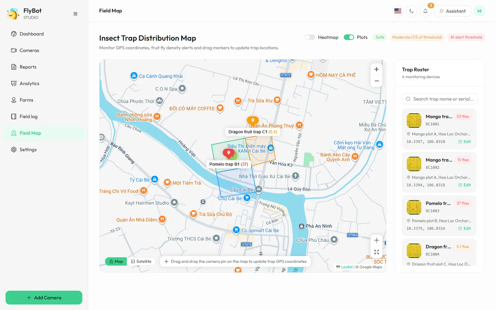<br><sub><b>Field map:</b> traps, plots and a density heat map</sub></td>
</tr>
<tr>
<td width="50%">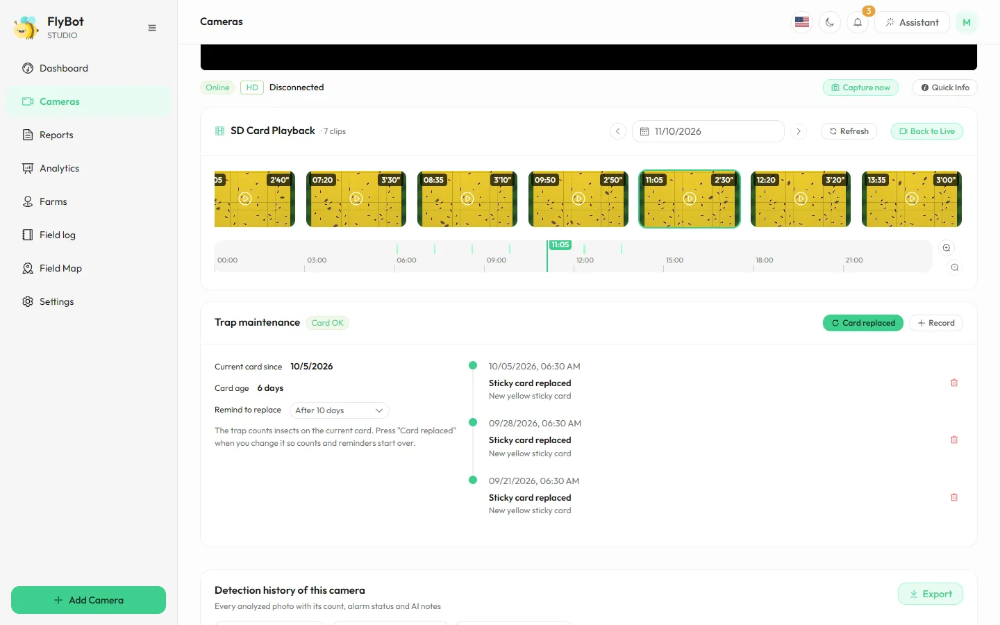<br><sub><b>Cameras:</b> live view and playback on a timeline</sub></td>
<td width="50%">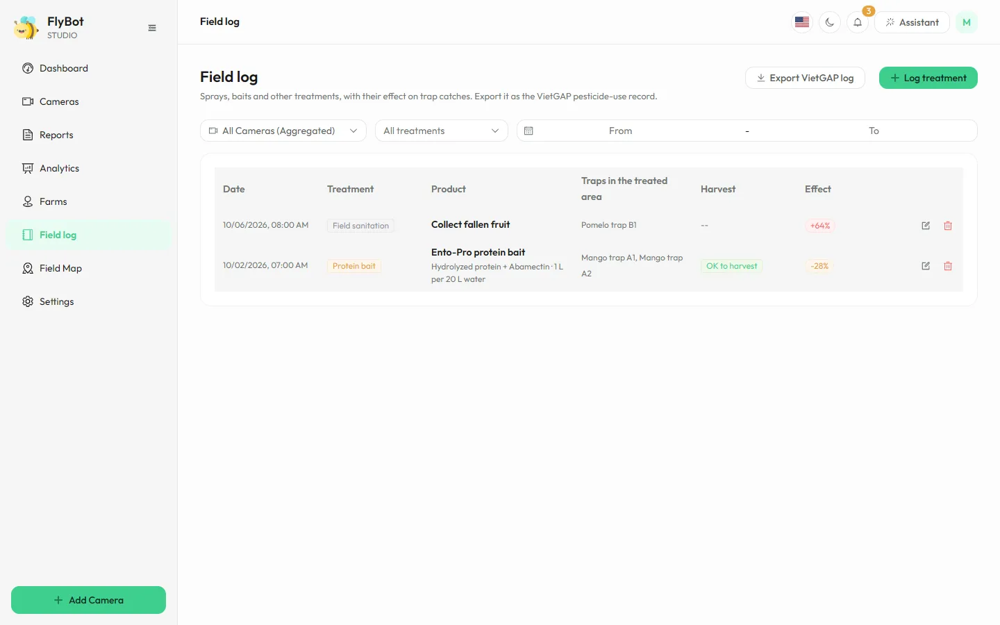<br><sub><b>Field log:</b> treatments with their effect on catches, VietGAP export</sub></td>
</tr>
</table>

<p align="center">
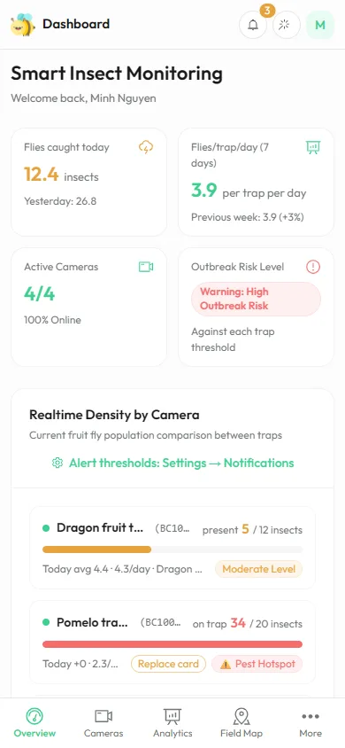
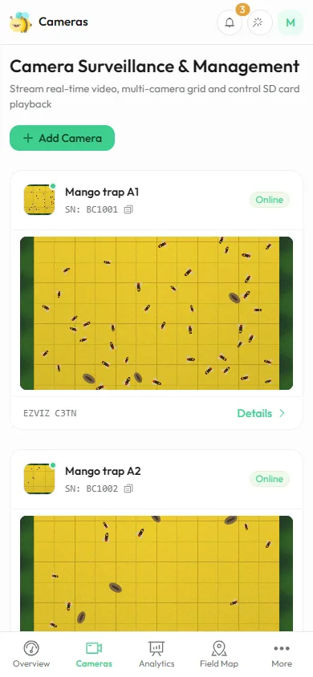
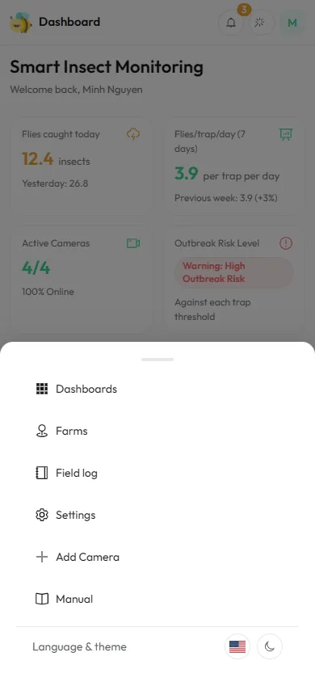
<br><sub>Installs on the phone like an app, with push notifications</sub>
</p>

Other screens: **Sentinel** (what the vision agent saw and proposed for each photo, and the proposals waiting for a decision), **Claim a camera** (take over a camera that registered itself), **Plan & usage** and **Plans** (limits and upgrades), and the admin pages (users, workspaces, plans, upgrade requests, audit log, capture pipeline). Screenshots in Vietnamese are in [client/public/manual/vi](client/public/manual/vi); the in-app **Guide** (`/manual`) explains every screen.

## Cameras

Each camera has a platform; the rest of FlyBot works the same for all of them.

| Platform | Camera | Photos | Live view |
|---|---|---|---|
| **EZVIZ** | Wi-Fi cameras on the EZVIZ Open Platform | FlyBot takes them on the camera's schedule | EZVIZ stream, SD-card playback |
| **CamOS on AWS IoT Core** | Open ESP32-S3 / AMB82 trap cameras (Wi-Fi or 4G, solar and battery, GPS) | The camera uploads on its own schedule and sleeps in between; **Capture now** asks it for a photo | Kinesis Video Streams WebRTC; a sleeping camera starts live view at its next wake |
| **Kinesis Video Streams** | Any camera that publishes to a KVS signaling channel | none | Kinesis Video Streams WebRTC |

A CamOS camera flashed with the public firmware **registers itself**: it shows a QR code with its serial and a 6-character code, and anyone signed in claims it on the **Claim a camera** page. Nothing secret is built into the firmware; FlyBot asks AWS IoT for the camera's certificate.

## Plans and workspaces

Every account has a **personal workspace**; businesses and cooperatives get an **organization** workspace with members (owner, manager, member). Someone in several workspaces switches between them in the top bar.

Each workspace is on a plan the administrator configures:

| | FREE | PRO | ENTERPRISE |
|---|---|---|---|
| Cameras | 3 | 10 + add-ons | 100 or more |
| Photos per camera a day | 48 | 96 | 288 |
| Deep photo analyses a month | 20 | 300 | 5000 |
| Members | 1 | 5 | no limit |
| PDF reports, API and webhooks | no | yes | yes |

These are starting values; the administrator changes them under **Settings → Plans**. When a limit is reached, FlyBot offers **Ask for an upgrade**; the administrator approves the request and arranges payment directly (FlyBot takes no payments).

`APP_MODE` sets how people join: `hybrid` (default: open sign-up with a personal workspace, organizations alongside), `b2c` (personal workspaces only) or `b2b` (organizations only, sign-up by invitation).

## How it is built

| Part | Built with |
|---|---|
| Web app (`client/`) | Vue 3, Vite, Element Plus, vue-i18n, Chart.js, Leaflet |
| API server (`server/`) | Node.js 22, Express 5, Mongoose 9 (MongoDB), node-cron |
| Photos | Amazon S3 (or any S3-compatible storage), private bucket |
| Counting | OpenCV 5 vision Lambda on AWS, or a Roboflow workflow; Google Vertex AI (Gemini) for the assistant |
| Cameras | EZVIZ Open Platform, AWS IoT Core, Kinesis Video Streams |
| Hosting | AWS (EC2, recommended) or Google Cloud Run / a VM ([DEPLOY.md](DEPLOY.md)) |

```
client/            Vue web app (pages, components, locales vi/en, guide screenshots in public/manual)
server/            Express API, background jobs (capture, AI retry, reports, cleanup), the assistant
  src/platforms/   camera platforms: EZVIZ, CamOS (AWS IoT Core), Kinesis Video Streams
  src/agent/       FlyBot assistant: prompts, tools, Gemini streaming loop
  tests/           node:test suite with an in-memory MongoDB, no outside services
  scripts/         maintenance scripts (rebuild stats, find orphan files, VAPID keys...)
deploy/            Google Cloud Run deploy script and settings template
docs/              AWS guide, AI model and dataset, README images
tools/             demo server, screenshots and tour recording, performance benchmarks
```

## Run it on your computer

Requirements: Node.js 22.12+, MongoDB, S3-compatible storage (Amazon S3 or MinIO), and for counting either the vision Lambda (run locally from flybot-aws, see [docs/flybot-aws-runbook.md](docs/flybot-aws-runbook.md)) or a Roboflow workflow. EZVIZ cameras need an EZVIZ Open Platform app (app key and secret).

The tour videos and the presentation decks are stored with [Git LFS](https://git-lfs.com): run `git lfs install` once before cloning (or `git lfs pull` afterwards).

```bash
npm install
cp .env.example .env        # then fill in the values (see the table below and the comments in the file)
npm run dev                 # API on :3003, web app on :3000
```

The first account that signs up becomes the administrator. `JWT_SECRET` must be at least 32 random characters, or the server refuses to start.

| Command | What it does |
|---|---|
| `npm run dev` | API and web app with reload |
| `npm test` | Server and web app tests (in-memory MongoDB, no outside services) |
| `npm run test:e2e` | The demo in headless Chrome: every main page and the main flows |
| `npm run build` | Web app into `client/dist`, server bundle into `server/dist` |
| `npm start` | Production server from `server/dist` |

To try the screens without real cameras, run the demo in [tools/media](tools/media/README.md).

## Run it on AWS

The recommended way is the one-command deployment in **flybot-aws** (`./deploy.sh`): it creates the S3 bucket, the vision Lambda, the AWS IoT Core thing type and policy, and an EC2 instance with MongoDB, Caddy (HTTPS) and FlyBot under systemd. FlyBot is built once on your computer and shipped as a release archive through S3, so the small EC2 instance never builds anything. Updates and rollbacks are the same command. See [DEPLOY.md](DEPLOY.md) and [docs/flybot-aws-runbook.md](docs/flybot-aws-runbook.md) for what runs where, the permissions and the checks.

Google Cloud Run and a plain VM with Docker are still supported ([DEPLOY.md](DEPLOY.md)).

## Configuration

All settings are environment variables, read from `.env` at the repository root (on AWS, flybot-aws writes them and keeps the secrets in AWS Secrets Manager). Empty values use the default.

**Server**

| Variable | Default | Meaning |
|---|---|---|
| `NODE_ENV` | `development` | `production` on a server |
| `PORT` | `3003` | Port the server listens on |
| `MONGO_URI` | `mongodb://localhost:27017/ezviz_manager` | MongoDB connection string |
| `JWT_SECRET` | (required) | At least 32 random characters; signs the sign-in tokens |
| `APP_BASE_URL` | | Public address of the app, used in email links and claim links (required in production) |
| `COOKIE_SECURE` | `false` | `true` when served over HTTPS |
| `TRUST_PROXY` | | `1` behind one reverse proxy (Caddy, a load balancer), so limits see the real client address |
| `CORS_ORIGINS` | | Extra origins allowed to call the API, comma-separated |
| `ENABLE_CRON` | `true` | `false` on every instance but one, so background jobs run once |
| `ALLOW_REGISTRATION` | `true` | `false` closes sign-up (also in Settings → System) |
| `RETENTION_CYCLE` | `3` | Months of photos kept (also in Settings → System) |
| `CAPTURE_CONCURRENCY` | `4` | Cameras captured and analyzed at the same time |
| `CONTACT_EMAIL` | | Contact address on the legal pages and for the contact form |
| `FLYBOT_SECRETS` | | AWS Secrets Manager secret names (comma-separated, each a JSON object of the settings below) read at start-up; values set in the environment win |

**Accounts, workspaces and plans**

| Variable | Default | Meaning |
|---|---|---|
| `APP_MODE` | `hybrid` | `hybrid`, `b2c` or `b2b` (see "Plans and workspaces") |
| `ALLOW_SIGNUP` | `false` | `b2b` only: `true` opens sign-up to everyone |
| `PLAN_RETENTION` | `false` | `true` deletes photos older than the workspace plan keeps them (otherwise only `RETENTION_CYCLE` applies) |
| `DEMO_MAX_CAMERAS_PER_USER` | `3` | FREE plan's first camera limit (then Settings → Plans) |
| `DEMO_MAX_SNAPSHOTS_PER_DAY` | `48` | FREE plan's first photos per camera a day |
| `DEMO_LIVE_MINUTES` | `5` | FREE plan's first live view minutes per request |
| `DEMO_MAX_UNCLAIMED` | `200` | Self-registered cameras that may wait for a claim at the same time |
| `DEMO_EXEMPT_EMAILS` | | Accounts without any plan limit, comma-separated (administrators have none either) |

**Photos (S3)**

| Variable | Default | Meaning |
|---|---|---|
| `S3_BUCKET_NAME` | | Bucket for photos (keep it private) |
| `S3_REGION` | `auto` | Bucket region (on AWS: `AWS_REGION`) |
| `S3_ENDPOINT` | | Empty for Amazon S3; the endpoint URL for MinIO or another S3-compatible store |
| `S3_ACCESS_KEY`, `S3_SECRET_KEY` | | Only for MinIO and similar; on AWS the instance role is used |
| `S3_PUBLIC_URL` | | Leave empty: photos are served through the API with access checks |
| `PHOTOS_BY_REFERENCE` | `true` on Amazon S3 | The vision Lambda reads photos by bucket and key; `false` sends signed links (MinIO) |

**Counting and the assistant**

| Variable | Default | Meaning |
|---|---|---|
| `AI_PROVIDER` | `roboflow` | `opencv-lambda` (the OpenCV 5 vision Lambda, recommended on AWS), `roboflow`, `vertex`, `both` or `sentinel` (an external agent posts the counts) |
| `VISION_LAMBDA_NAME` | | Name of the vision Lambda (invoked with the AWS SDK) |
| `VISION_LAMBDA_URL` | | Local development: address of a vision Lambda running on your computer (wins over the name) |
| `VISION_LAMBDA_TIMEOUT_S` | `120` | Seconds to wait for the Lambda |
| `ROBOFLOW_API_KEY`, `ROBOFLOW_WORKFLOW_URL` | | Roboflow workflow for `AI_PROVIDER=roboflow` ([docs/AI_MODEL.md](docs/AI_MODEL.md)) |
| `ROBOFLOW_UPLOAD_PROJECT`, `ROBOFLOW_UPLOAD_API_KEY`, `ROBOFLOW_UPLOAD_CLASS` | | Send reviewed photos to Roboflow for retraining |
| `VERTEX_PROJECT_ID`, `VERTEX_LOCATION`, `VERTEX_MODEL` | `global`, `gemini-3.5-flash-lite` | Google Vertex AI (Gemini) for the assistant |
| `GOOGLE_APPLICATION_CREDENTIALS` | | Google service account key file for Vertex AI |
| `SENTINEL_CONSOLE` | `false` | `true` shows the Sentinel screen with another `AI_PROVIDER` (it is on with `opencv-lambda`) |
| `SENTINEL_API_SECRET` | | Shared key of the signed vision agent API (`/api/sentinel`, at least 32 characters); empty = off |
| `SENTINEL_CAPTURE_BUDGET`, `SENTINEL_PROPOSAL_TTL_HOURS` | `4`, `24` | Extra photos the agent may ask for per camera a day; hours a proposal waits for a decision |

**AWS: cameras and live view**

| Variable | Default | Meaning |
|---|---|---|
| `AWS_REGION` | `ap-southeast-2` | Region of every AWS service FlyBot calls; credentials come from the instance role (or `AWS_ACCESS_KEY_ID` / `AWS_SECRET_ACCESS_KEY` on a computer) |
| `IOT_ENDPOINT` | | AWS IoT Core data endpoint (`aws iot describe-endpoint --endpoint-type iot:Data-ATS`) |
| `IOT_EVENTS` | `mqtt` | How camera messages reach FlyBot: `mqtt` (FlyBot subscribes), `rule` (an IoT rule posts them to `/api/device/events`) or `off` |
| `IOT_RULE_SECRET` | | Shared secret of that IoT rule |
| `IOT_THING_TYPE`, `IOT_POLICY_NAME` | `camos-camera` | Thing type and device policy for self-registered cameras |
| `KVS_VIEWER_ROLE_ARN` | | IAM role the browser uses (through FlyBot, 15 minutes) to watch a camera over Kinesis Video Streams; empty = no live view for CamOS cameras |
| `SELF_REGISTRATION` | `true` | `false` turns off camera self-registration |
| `REGISTER_MAX_PER_IP_HOUR`, `REGISTER_MAX_PER_HOUR` | `5`, `60` | Self-registrations per client address and in total, per hour |
| `DEVICE_API_BASE_URL` | `APP_BASE_URL` | Address the cameras call |
| `DEVICE_DEFAULT_TIMEZONE` | `Asia/Ho_Chi_Minh` | Camera clock when neither the farm, GPS nor the network tells |
| `DEVICE_OTA_FW`, `DEVICE_OTA_URL`, `DEVICE_OTA_SHA256` | | Firmware version, link and checksum offered to the cameras |

**EZVIZ cameras**

| Variable | Default | Meaning |
|---|---|---|
| `APP_KEY`, `SECRET_KEY` | | EZVIZ Open Platform app key and secret |
| `EZVIZ_DOMAIN` | `https://ivnopen.ezvizlife.com` | EZVIZ API address for your region |
| `EZVIZ_RAM_TOKENS` | `false` | `true` gives each viewer an EZVIZ sub-account token limited to their cameras ([DEPLOY.md](DEPLOY.md), Known risks) |

**Email, Telegram, notifications, maps**

| Variable | Default | Meaning |
|---|---|---|
| `SMTP_HOST`, `SMTP_PORT`, `SMTP_SECURE`, `SMTP_USER`, `SMTP_PASS`, `MAIL_FROM` | `587`, `false` | Email for password reset, confirmations and alerts; without `SMTP_HOST` emails are only logged |
| `TELEGRAM_BOT_TOKEN`, `TELEGRAM_BOT_USERNAME` | | Telegram alerts and confirm buttons |
| `VAPID_PUBLIC_KEY`, `VAPID_PRIVATE_KEY`, `VAPID_SUBJECT` | | Push notifications (`node server/scripts/generate_vapid_keys.js`) |
| `WEBHOOK_ALLOW_PRIVATE` | | Development only: allow webhooks to a local receiver |
| `VITE_GOOGLE_MAP_KEY` | | Google Maps layers in the web app (build time) |
| `VITE_HOME_VIDEO_URL` | | Video on the home page instead of the built-in tour (build time) |

More about email, Telegram, push notifications and daily statistics: [server/README.md](server/README.md).

## Documentation

- [DEPLOY.md](DEPLOY.md): AWS (recommended), Google Cloud Run and VM deployment, checks after a deploy, known risks
- [docs/flybot-aws-runbook.md](docs/flybot-aws-runbook.md): FlyBot on AWS: architecture, permissions, CamOS cameras, local development with the vision Lambda
- [API.md](API.md): API reference (app, integrations and webhooks, cameras, vision agent, administration)
- [docs/AI_MODEL.md](docs/AI_MODEL.md): the fruit fly detection models and how to retrain them
- [server/README.md](server/README.md): server features and settings
- [client/UI_GUIDELINES.md](client/UI_GUIDELINES.md): UI rules for the web app
- [tools/media/README.md](tools/media/README.md): demo, screenshots and product tour
- [CONTRIBUTING.md](CONTRIBUTING.md): development conventions and tests
- [SECURITY.md](SECURITY.md): reporting a vulnerability
- [CHANGELOG.md](CHANGELOG.md): what changed

## License

[AGPL-3.0](LICENSE) © 2026 AGRHUB. Versions up to 1.5.0 were released under the MIT licence.
