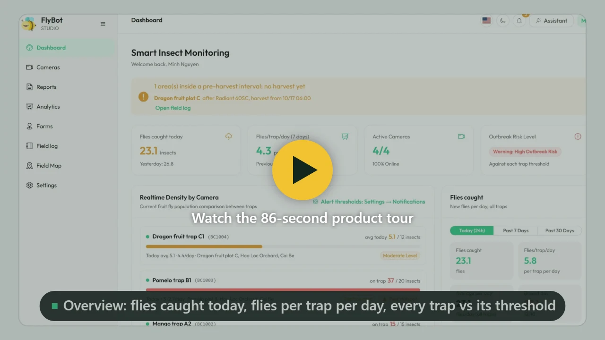

# FlyBot

**Smart insect traps: the camera shoots, the AI counts.**

FlyBot watches sticky and lure traps through EZVIZ cameras, counts the insects on every photo with AI (fruit flies first), and tells growers when a trap crosses its threshold. It runs in the browser and installs on the phone like an app, in Vietnamese and English.

Website: <https://ezviz.agrhub.com> · Contact: <contact@agrhub.com>

[](https://ezviz.agrhub.com/media/flybot-tour-en.mp4)

Product tour (1080p, 86 s): [English](https://ezviz.agrhub.com/media/flybot-tour-en.mp4) · [Tiếng Việt](https://ezviz.agrhub.com/media/flybot-tour-vi.mp4). The files are also in the repository: [client/public/media](client/public/media).

## Features

- **Catches per trap per day.** Sticky traps count the daily rise on the glue card; lure traps count the average per photo. Flies per trap per day compare traps and weeks fairly.
- **AI detection** with an RF-DETR model trained on Roboflow ([camos/fruit-fly-wmcqi](https://universe.roboflow.com/camos/fruit-fly-wmcqi), 96% mAP@50 on the test split; insect boxes and species) and Google Vertex AI (Gemini) for diagnosis and photo review. People can confirm or correct each count; corrected photos can go back to Roboflow for retraining.
- **Cameras:** live view, SD-card playback on a timeline, scheduled captures, image-quality checks and a card-replacement reminder.
- **Alerts** by email, Telegram and push notification, with per-trap thresholds, quiet hours and a 06:30 morning brief.
- **Analytics and reports:** charts per trap, hour and period, a 7-day forecast and degree-day outlook, report builder with scheduled PDF emails, shareable links with expiry, PDF/Excel export with the detection boxes.
- **FlyBot assistant:** an agent that looks up real data (catches, alerts, cameras, reports, treatments), shows photos and charts, takes a new photo, and proposes changes that only apply after you confirm them.
- **Farms and organizations:** farms with plots drawn on a map, a treatment logbook with VietGAP export, organizations with owner/manager/member roles, and sharing per camera, farm or report.
- **Admin:** users and roles, all cameras, audit log, system settings and a capture pipeline monitor.
- **Public API and webhooks** for other systems ([API.md](API.md)).

## Screenshots

<table>
<tr>
<td width="50%"><br><sub><b>Overview:</b> flies caught today, flies per trap per day, every trap against its threshold</sub></td>
<td width="50%"><br><sub><b>AI detection:</b> every fly boxed and counted; confirm or correct the count</sub></td>
</tr>
<tr>
<td width="50%"><br><sub><b>FlyBot assistant:</b> answers from real data, with photos and charts</sub></td>
<td width="50%"><br><sub><b>In-depth analysis:</b> per-trap table, daily catches, temperature, catches by hour</sub></td>
</tr>
<tr>
<td width="50%"><br><sub><b>Reports:</b> build, export to PDF, share with expiry, send weekly or monthly</sub></td>
<td width="50%"><br><sub><b>Field map:</b> traps, plots and a density heat map</sub></td>
</tr>
<tr>
<td width="50%"><br><sub><b>Cameras:</b> live view and SD-card playback on a timeline</sub></td>
<td width="50%"><br><sub><b>Field log:</b> treatments with their effect on catches, VietGAP export</sub></td>
</tr>
</table>

<p align="center">


<br><sub>Installs on the phone like an app, with push notifications</sub>
</p>

Screenshots in Vietnamese are in [client/public/manual/vi](client/public/manual/vi).

## Tech stack

| Part | Built with |
|---|---|
| Web app (`client/`) | Vue 3, Vite, Element Plus, vue-i18n, Chart.js, Leaflet |
| API server (`server/`) | Node.js, Express 5, Mongoose 9 (MongoDB), node-cron |
| Storage | S3-compatible object storage for photos |
| AI | Roboflow workflows, Google Vertex AI (`@google/genai`) |
| Hosting | Docker: Google Cloud Run or a Compute Engine VM ([DEPLOY.md](DEPLOY.md)) |

## Repository layout

```
client/            Vue web app (pages, components, locales vi/en, guide screenshots in public/manual)
  tests/           Vitest unit and component tests, end-to-end smoke test on the demo
server/            Express API, cron jobs (capture, AI retry, reports, cleanup), assistant agent
  src/agent/       FlyBot assistant: prompts, tools, Gemini streaming loop
  tests/           node:test suite with an in-memory MongoDB
  scripts/         maintenance scripts (rebuild stats, find orphan files, VAPID keys...)
deploy/            Cloud Run deploy script and settings template
docs/              AI model and dataset, README images
tools/media/       demo server, screenshot and product-tour recording tools
tools/perf/        performance benchmarks
API.md             public API and webhooks
DEPLOY.md          Cloud Run and VM deployment
```

## Getting started

Requirements: Node.js 20.19+ or 22.12+, a MongoDB database, S3-compatible storage, an EZVIZ Open Platform app (app key and secret) and a Roboflow workflow.

```bash
npm install
cp .env.example .env        # then fill in the values (see the comments in the file)
npm run dev                 # API on :3003, web app on :3000
```

The first account that signs up becomes the admin. `JWT_SECRET` must be at least 32 random characters, or the server refuses to start.

Optional: SMTP settings for emails, `TELEGRAM_BOT_TOKEN` for Telegram alerts, VAPID keys for push notifications (`node server/scripts/generate_vapid_keys.js`), `VITE_GOOGLE_MAP_KEY` for Google Maps layers, and a GCP service account (`GOOGLE_APPLICATION_CREDENTIALS`) for the assistant locally. See [server/README.md](server/README.md) for roles, push notifications and the server settings.

## Scripts

| Command | What it does |
|---|---|
| `npm run dev` | API and web app with reload |
| `npm test` | Server and web app tests (in-memory MongoDB, no external services) |
| `npm run test:e2e` | The demo in headless Chrome: every main page and the main flows |
| `npm run build` | Web app into `client/dist`, server bundle into `server/dist` |
| `npm start` | Production server from `server/dist` |

## Deployment

```bash
node deploy/deploy-cloudrun.js --check   # what .env provides for production, no gcloud
deploy/deploy-cloudrun.sh                # or deploy\deploy-cloudrun.bat on Windows
```

The script sets up the Google Cloud project, stores secrets in Secret Manager, builds and deploys to Cloud Run, then checks `/health`. For a VM, use `docker compose up -d --build`. Everything is in [DEPLOY.md](DEPLOY.md).

## Documentation

- [DEPLOY.md](DEPLOY.md): deployment, settings and post-deploy checks
- [API.md](API.md): public API and webhooks
- [docs/AI_MODEL.md](docs/AI_MODEL.md): the fruit fly detection model, its dataset and scores, and how to retrain it
- [server/README.md](server/README.md): server configuration, roles, push notifications
- [client/UI_GUIDELINES.md](client/UI_GUIDELINES.md): UI rules for the web app
- [tools/media/README.md](tools/media/README.md): demo, screenshots and product-tour video
- [CONTRIBUTING.md](CONTRIBUTING.md): development conventions and tests
- [SECURITY.md](SECURITY.md): reporting a vulnerability
- [CHANGELOG.md](CHANGELOG.md): what changed
- In the app: the **Guide** page (`/manual`), with screenshots in both languages

## License

[MIT](LICENSE) © 2026 AGRHUB
